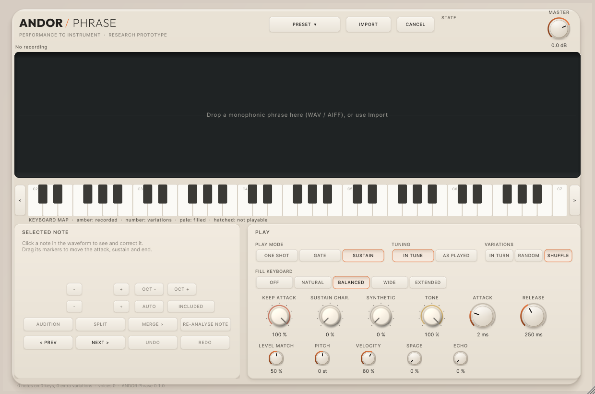
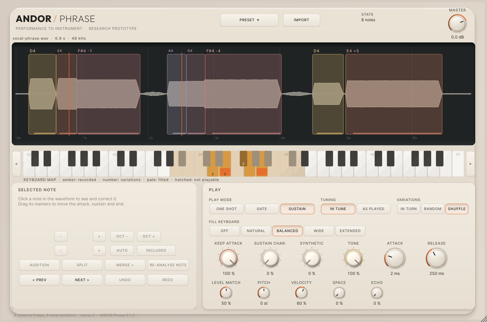
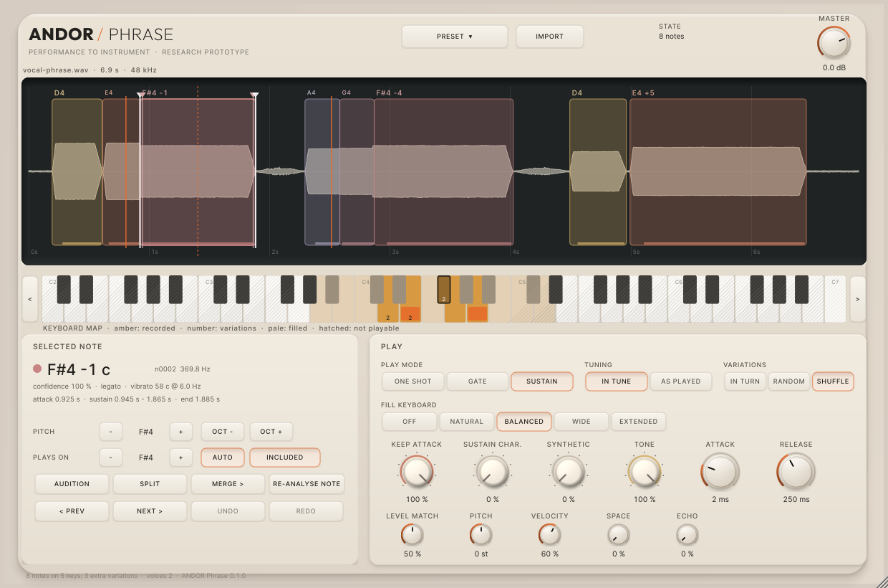
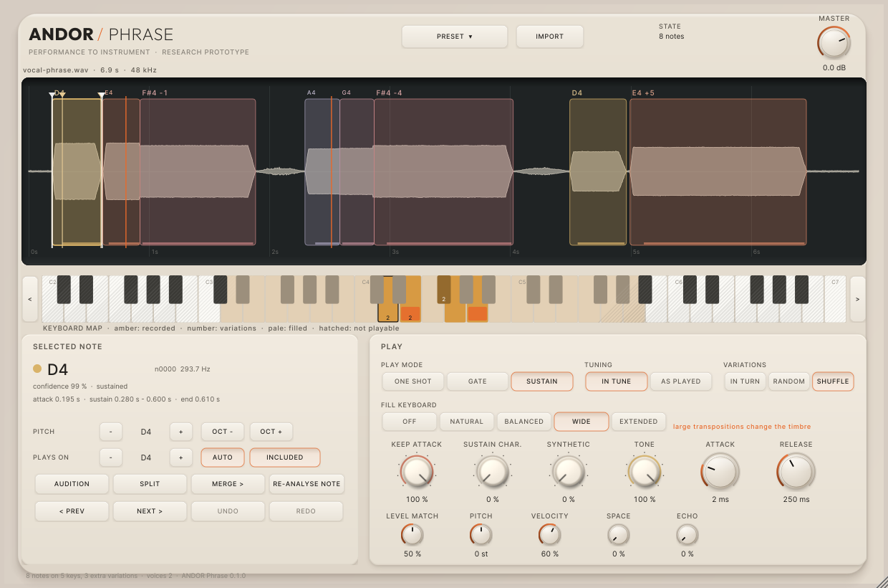
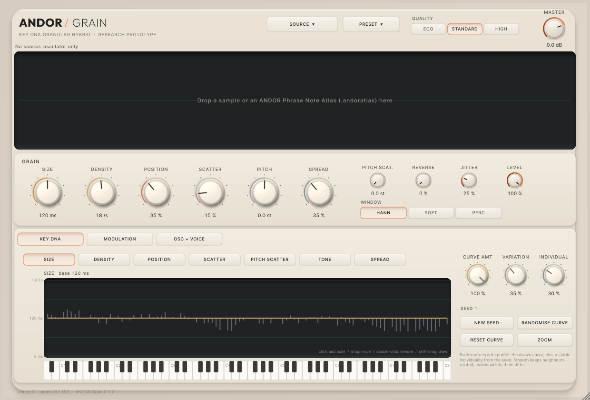
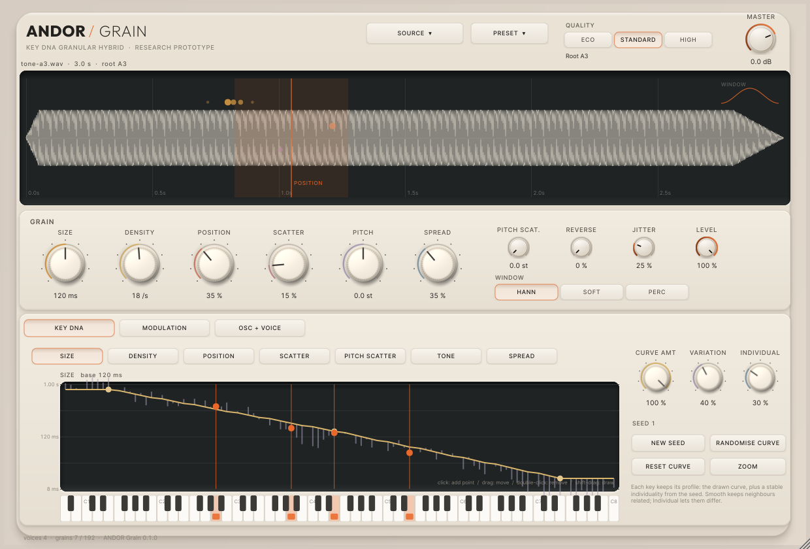
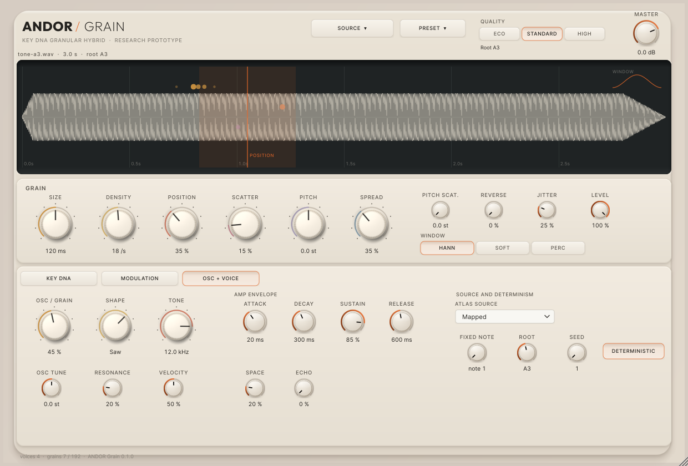
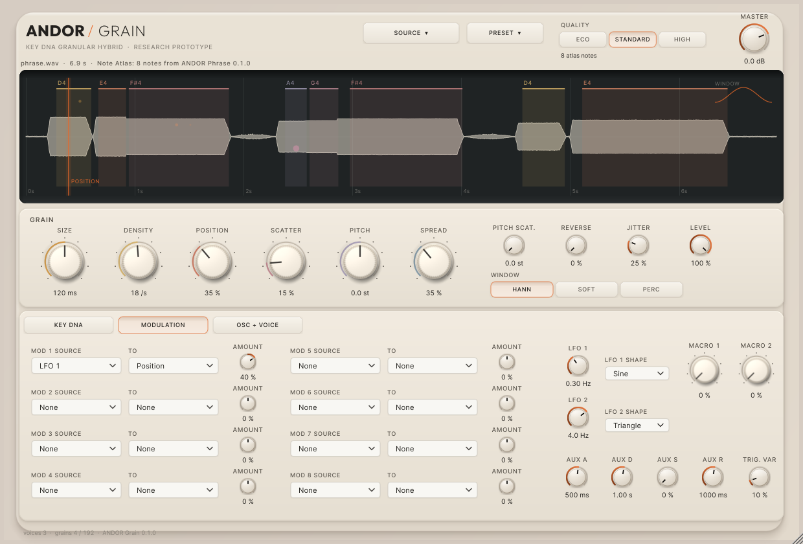

# ANDOR Lab — ANDOR Phrase + ANDOR Grain

Two research-prototype instruments built in this repository on branch `andor-lab`, sharing one
data model so they can later become one hybrid:

- **ANDOR Phrase** turns a recorded monophonic performance into a polyphonic instrument:
  notes detected, pitched, mapped to their keys, repeats as variations, gaps filled within
  explicit limits, immediately playable, quickly correctable.
- **ANDOR Grain** is a polyphonic granular hybrid where every key has its own stable granular
  identity (KEY DNA), with an oscillator blend and per-voice modulation; it can play the notes
  of an ANDOR Phrase Note Atlas at their own pitches.

Status: **engineering-complete development prototypes, host validation pending.** No
installer. Read `handoff.md` first.

| Document | Contents |
| --- | --- |
| [handoff.md](handoff.md) | the final report: repository, products, builds, verification, review, future hybrid, installer readiness |
| [audit.md](audit.md) | Milestone 0: isolation, baseline, Drums branch, assets, dependencies, layout decisions |
| [note-atlas.md](note-atlas.md) | the shared Note Atlas, schema version 1 |
| [phrase-analysis.md](phrase-analysis.md) | Phrase's analysis pipeline, backends, evaluation (incl. the held-out stress history) |
| [phrase.md](phrase.md) | ANDOR Phrase: mapping, modes, controls, editing, state |
| [grain.md](grain.md) | ANDOR Grain: engine, budget, oscillator, modulation, KEY DNA, Note Atlas sources, state |
| [benchmarks.md](benchmarks.md) | CPU matrix (container hardware) and memory |
| [build-and-validation.md](build-and-validation.md) | targets, identities, commands, artefacts, pluginval, dev install on a Mac |
| [test-instructions.md](test-instructions.md) | what the user runs on the Mac: Standalone, Ableton, listening, real recordings |
| [known-issues.md](known-issues.md) | open items and limitations |
| [CHANGELOG.md](CHANGELOG.md) | 0.1.0 |
| `screens/` | the eight review states, rendered from the working plug-ins |
| `data/` | evaluation and benchmark outputs, pluginval logs |

## Review screens (rendered by the plug-in tests, not mock-ups)

| | |
| --- | --- |
|  |  |
| 1 Phrase, empty | 2 Phrase, analysed (regions, read heads, keyboard map) |
|  |  |
| 3 Phrase, note correction (markers, split cursor) | 4 Phrase, keyboard mapping (WIDE fill) |
|  |  |
| 5 Grain, empty | 6 Grain, KEY DNA (curve, individuality, sounding keys) |
|  |  |
| 7 Grain, sample + oscillator | 8 Grain, Note Atlas from Phrase + modulation |

Regenerate: `ANDOR_SCREENSHOT_DIR=docs/andor-lab/screens xvfb-run -a build-plugin/apps/phrase/andor_phrase_plugin_tests "[editor]"`
(and the Grain counterpart).
