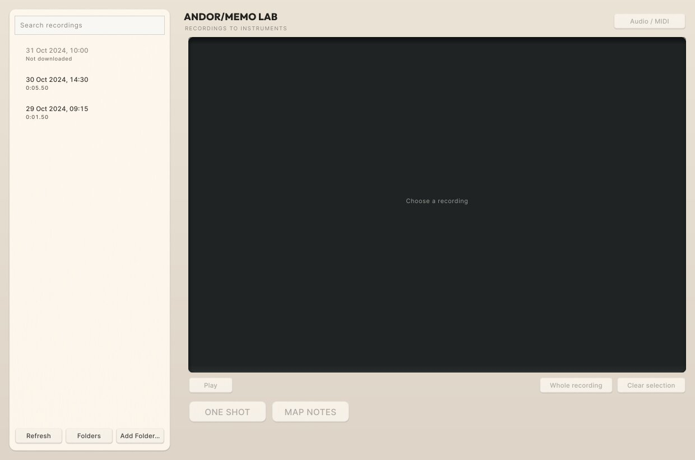
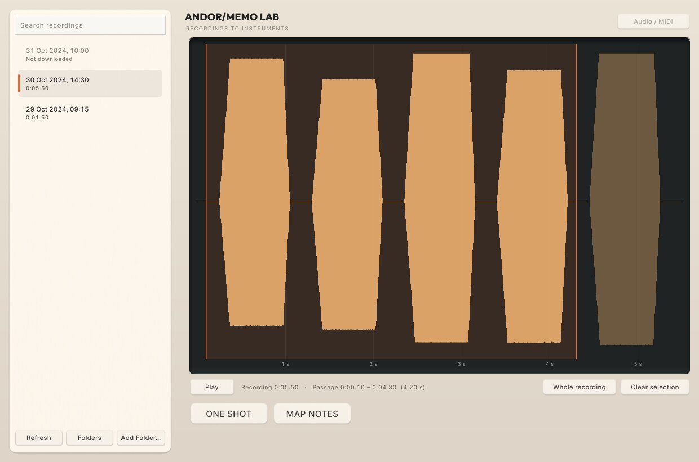
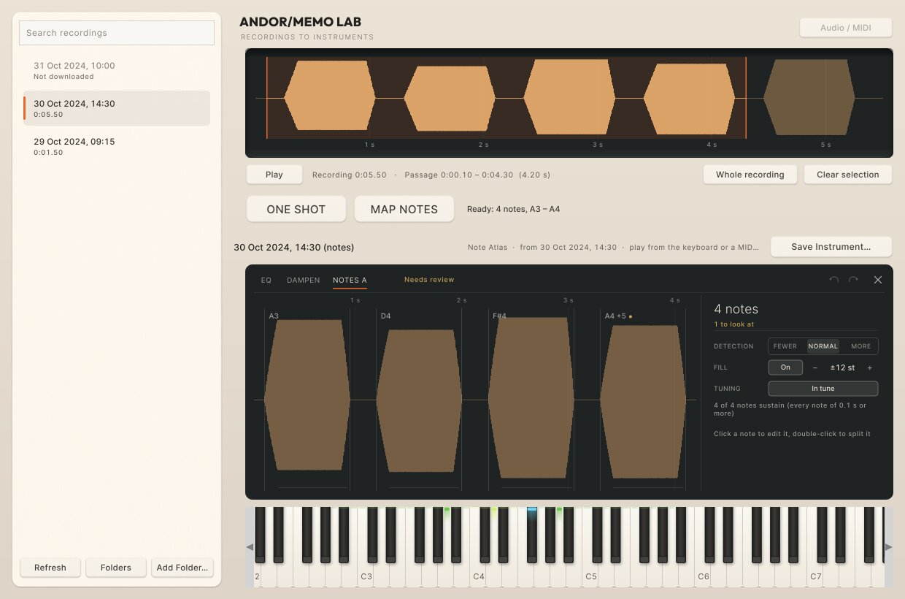
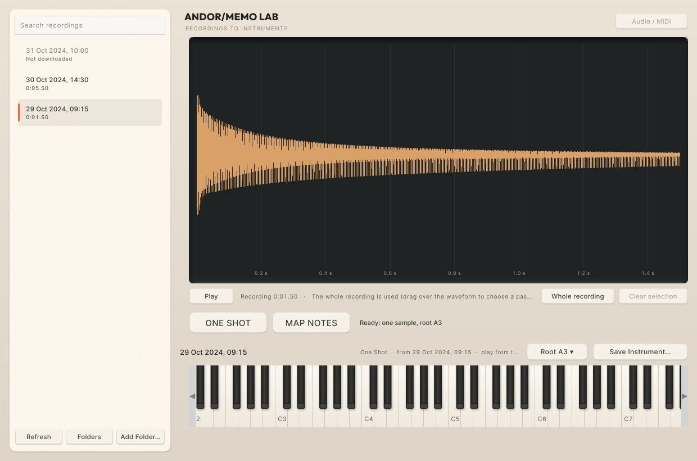
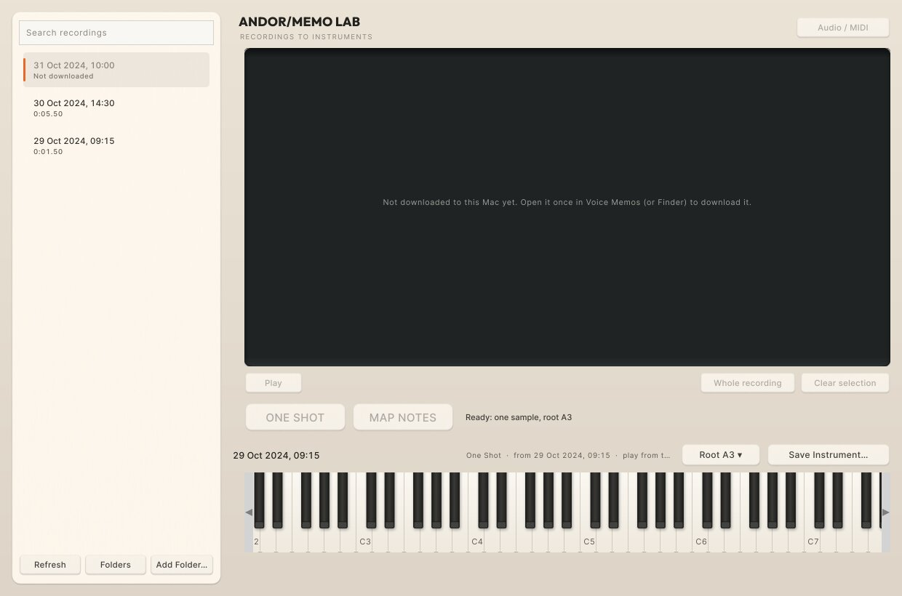

# ANDOR Memo Lab 0.1 — recordings to playable instruments

You record something on your iPhone, find it on the Mac, click one button, and play it as an
ANDOR instrument. Then you save it and open it in ANDOR OSP.

Memo Lab is a small standalone Mac app. It runs ANDOR OSP's own processor (see
`architecture.md`), so ONE SHOT, MAP NOTES, the sound and the saved file are exactly the
plugin's. It is a private development prototype, not a release: no signing, no installer
beyond the test build's `install.command`.

| | |
|---|---|
|  |  |
| The recordings (newest first), not yet chosen | A recording chosen, a passage dragged over it |
|  |  |
| MAP NOTES: the notes on their keys, OSP's NOTE MAP to correct them | ONE SHOT: one sample across the keyboard, its root |
|  |  |
| A memo not downloaded to this Mac yet: says so | No folder it can read: says what happened and what to do |

These screenshots come from the real window, rendered headlessly with test recordings. They
are not your memos.

## Getting it

The macOS test build (CI artifact `OSP-macOS-test`) contains `ANDOR Memo Lab.app`. Run
`install.command` and it copies the app to `~/Applications` next to OSP. Or build it yourself:
`cmake -B build-plugin -G Ninja -DOSP_BUILD_PLUGIN=ON && cmake --build build-plugin --target ANDOR_Memo_Lab`.

## Testing guide (about ten minutes)

1. **Record.** On the iPhone, open Voice Memos and record about 10 seconds of a sung or bowed
   melody: separate notes, a little space between them. Wait for it to sync (it appears in
   Voice Memos on the Mac).
2. **Open Memo Lab.** On first launch it looks in the Mac's Voice Memos folder
   (`~/Library/Group Containers/group.com.apple.VoiceMemos.shared/Recordings`).
   - If macOS asks whether Memo Lab may access data from other apps, allow it. This is the
     permission to read Voice Memos' folder; Memo Lab only reads it.
   - If the list stays empty and says the folder cannot be read, either allow it in System
     Settings > Privacy & Security, or choose **Add Folder…** and pick a folder of recordings
     (for example, memos you dragged out of Voice Memos into a folder).
   - Memo Lab never asks for Full Disk Access by itself.
3. **Find the memo.** It is at the top (newest first); the search box filters by name.
   - Titles come from Voice Memos' own list when it can be read; otherwise from the file name
     (the moment it was recorded).
   - "Not downloaded" means iCloud has not brought it to this Mac yet: open it once in Voice
     Memos, then **Refresh**.
4. **Listen.**
   - Click the memo, then **Play** (or Space). Click the waveform to jump.
   - Drag over the waveform to choose a passage; **Play** then plays only that.
   - **Whole recording** selects everything, and **Clear selection** clears the passage.
5. **MAP NOTES.**
   - The status reads "Finding the notes…", then "Playable", then "Ready: N notes, A3 – F5".
   - The keys light where the notes are. Play them from the Mac's keyboard (click the keyboard
     first; the A-S-D-F row) or from a MIDI controller; choose the device in **Audio / MIDI**.
   - The NOTE MAP below is the plugin's own: click a note to correct its pitch, leave it out,
     audition it, split or merge it. Its EQ and DAMPEN tabs do nothing in Memo Lab.
6. **Save Instrument…** It offers `Documents/OSP/Instruments`, OSP's own instrument folder.
7. **In Ableton:**
   1. Load ANDOR OSP and open its main menu > **Instruments** > your instrument (or **Open
      instrument file…** if you saved it elsewhere). Play it.
   2. Save the Live set, close it, and open it again: it should still play.
8. **ONE SHOT.** Choose another memo (a hum, a pluck, a single note) and press **ONE SHOT**.
   It plays across the keyboard from its detected root; **Root ▾** corrects it. Save and open
   it the same way.

### Please note down

- Whether the memo appeared without exporting, and whether macOS asked for permission.
- How long MAP NOTES took to become playable, and whether the notes landed on the right keys.
- Whether the saved instrument opened and played in Ableton, and again after reopening the set.

## What it never does

- It never changes, renames, moves or deletes a recording, and never writes into Voice Memos'
  folder or its database.
- It never analyses a recording until you choose MAP NOTES or ONE SHOT on it.
- Nothing leaves the Mac: no network, no account, no telemetry, no transcription.
- Its working copy of a passage (in `~/Library/Application Support/ANDOR/Memo Lab/Passages`)
  is replaced by the next conversion and removed when the app quits. The instrument's audio
  lives in OSP's own sample store, and inside the saved `.ospinstrument`.

## Results so far

| Check | Result |
|---|---|
| Sources: approved folders remembered, added once, removed | pass (tests) |
| Scan: ready / not downloaded / still syncing / unreadable; hidden files, app packages, links out of the folder, non-audio skipped; missing and empty folders reported | pass |
| Decoding: WAV, AIFF, mono and stereo, 44.1 / 48 kHz, truncation at 15 minutes, corrupt and missing files refused; originals byte-identical | pass |
| AAC `.m4a` (mono and stereo, made by `afconvert`) through CoreAudio and through AVFoundation | in the macOS CI run (not on Linux) |
| A passage is exactly the chosen frames | pass |
| ONE SHOT → playable across the keyboard → saved → opens in a fresh OSP with an empty sample store and the recording deleted | pass |
| MAP NOTES on a 4-note sung phrase → 4 notes on their keys → saved → opens the same way with every note and no missing audio | pass |
| A passage maps only its own notes | pass |
| Noise → "Not suitable for note mapping", plays as one sample, can be saved | pass |
| Playing a mapped memo: no allocation in `processBlock` | pass |
| The window: lists, reads, maps, one-shots, shows not-downloaded and no-folder states | pass |
| Speed, Linux VM: a 10 s ten-note melody, MAP NOTES playable after 0.93 s and ready after 1.7 s; a 2.5 s hum, ONE SHOT 0.23 s | measured |
| Speed, Apple Silicon | CI step "Memo Lab timing" |

## Known limitations

- **Unverified until tried on your Mac:**
  - the real Voice Memos folder and macOS's permission prompt;
  - real iPhone memos (`.m4a`, and the newer `.qta`, which goes through the AVFoundation
    reader);
  - CoreAudio and MIDI devices;
  - the Ableton round trip;
  - iCloud sync itself.
  The tests prove the same paths with generated files and a fresh processor standing in for
  another computer.
- **Titles from Voice Memos' database are best-effort.** It is read only and without locking;
  if its layout differs, file-name titles are shown instead. Voice Memos' folders are not
  shown.
- **Folder access.** Without the sandbox there are no security-scoped bookmarks; approved
  folders are plain paths. A folder macOS refuses is reported, not worked around.
- **No folder watching.** Use **Refresh** after a new memo syncs.
- **One recording in memory** (up to 15 minutes), one conversion at a time; analysis covers at
  most OSP's 180 s per recording.
- **NOTE MAP** shows its EQ and DAMPEN tabs, which do nothing here.
- **The Library.** Because OSP's processor does the loading, what Memo Lab loads may also be
  noted in OSP's Library catalog, as the plugin's own loads are.
