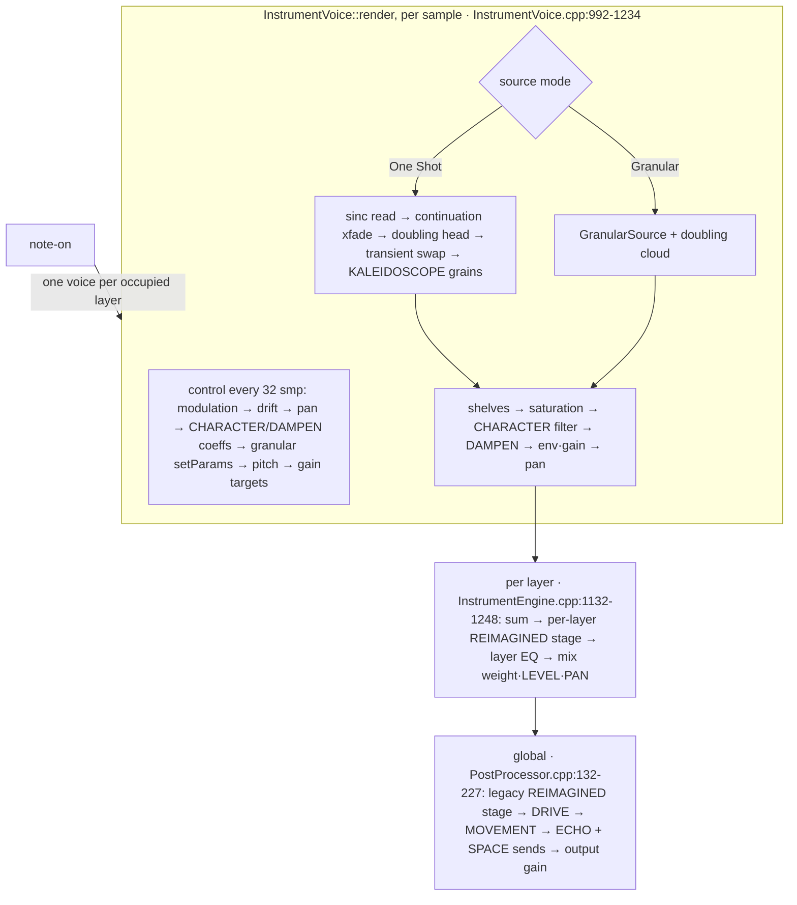

# 01 — Current OSP audit (what exists now)

Source: `claude/charming-lovelace-n25fte` at `db136e5` (CPU step 2). Read-only audit; every
claim cites code. Tags: **[IMPL]** implemented and tested, **[LIMITED]** implemented with a
real limitation, **[PARTIAL]**, **[ABSENT]**. "INFERRED" marks reading-based conclusions not run.

## 1. Source architecture

| Area | Status | Evidence |
|---|---|---|
| Immutable, padded, shared source (`PlaybackSource`, ≤ 2 channels, mono maps to ch 0) | [IMPL] | `src/model/PlaybackSource.h:13-75` |
| `InstrumentModel` = `original` + register `anchors`; `layerFor()` picks the nearest anchor | [IMPL] | `src/model/InstrumentModel.h:25-35, 115-129` |
| Build stages provisional → continued → complete, off the audio thread | [IMPL] | `src/engine/InstrumentBuilder.cpp:138-199` |
| Lock-free hand-over per layer (`ModelExchange`, 8 retired slots, kept alive while in use) | [IMPL] | `PluginProcessor.h:503-521`, `.cpp:1970-2015`, `src/model/ModelExchange.h:29-72` |
| Content-hash sample store, relink by hash then path | [IMPL] | `apps/plugin/Source/InstrumentLoader.cpp:102-155` |
| Pitch: no resampling at load; `increment = 2^((note-root)/12)·srcRate/outRate` | [IMPL] | `InstrumentEngine.cpp:834`, `InstrumentVoice.cpp:1011` |
| One Shot reads: band-limited sinc (`SincInterpolator::readFast`, SIMD) | [IMPL] | `InstrumentVoice.cpp:931-935`, `SincInterpolator.cpp` |
| Root override as layer pitch offset | [IMPL] | `PluginProcessor.cpp:3114-3124`, `InstrumentEngine.cpp:258-263` |
| START / REVERSE / LOOP / FOLLOW, continuation walk + release graft | [IMPL] | `InstrumentVoice.cpp:107-153, 451-582, 899-907` |
| Polyphony per layer (24 in the plugin, max 64), steal: released → quietest → oldest | [IMPL] | `InstrumentEngine.cpp:497-517, 749-762`; `PluginProcessor.cpp:884` |
| Two voices per key per layer; inaudible-voice retirement (−90 dBFS, 0.25 s) | [IMPL] | `InstrumentEngine.h:109-116`, `.cpp:733-748, 1221-1232` |
| Sustain pedal, mono legato + glide | [IMPL] | `InstrumentEngine.cpp:658-722, 861-881` |

## 2. Multi-sample — the existing hook for a Note Atlas

**This matters most for the Phrase integration: OSP already has a multi-region source model.**

| Area | Status | Evidence |
|---|---|---|
| A layer can hold an `InstrumentSet`: members (one `InstrumentModel` each), pitch groups, velocity layers, round-robin takes; "a single file is a set with one member" | [IMPL] | `src/model/InstrumentSet.h:13-78` |
| Inference: pitch groups (roots within ½ st), velocity layers (names or ≥ 4.5 dB gaps), round-robin, articulations kept but unplayed, user assignments, levelling, multi-velocity learning, register model | [IMPL] | `src/engine/SampleSetInference.cpp:84-332` |
| Region choice per note (`memberFor`): nearest root group, velocity layer, seeded never-repeat round-robin | [LIMITED] — no key ranges, no fill limit (transposition unlimited), no crossfades | `InstrumentEngine.cpp:367-414` |
| Each member plays at its own root; shared set gain; register brightness shelf | [IMPL] | `InstrumentEngine.cpp:782-785, 834` |
| Per-layer stages (REIMAGINED stage, resonators, auto-POS) use the *primary* member only | [LIMITED] | `InstrumentEngine.cpp:1158, 1259`; `PluginProcessor.h:519` |
| GUI: drop a folder (or choose several files) → one multi-sample layer; Samples inspector (role/layer/root per file, re-inference without re-analysis) | [IMPL] | `PluginEditor.cpp:964-1052, 1198-1218`; `InstrumentLoader.cpp:391-497` |
| Members are separate files; no sub-ranges of one buffer | [ABSENT] | `PitchLayer`/`PlaybackPreparation` hold whole buffers |
| Note Atlas, KEY DNA, pitch-detected regions | [ABSENT] | repo-wide search |

## 3. The Granulator (GRANULAR source mode) — proven from code

| Question | Answer | Evidence |
|---|---|---|
| Genuinely granular? | **Yes.** Independent grains with own position, ratio, Hann window (by rotation), direction, gain, length | `GranularSource.h:68-77`, `.cpp:135-183` |
| Per voice, per layer or global? | **Per voice.** Every `InstrumentVoice` owns a `GranularSource` (+ a second `doubleSource` for REIMAGINED doubling). Several held notes = several independent clouds with independent PRNGs | `InstrumentVoice.h:279, 284`; `GranularSource.h:88` |
| Scheduling | Per sample countdown; interval `sr/density · U(0.8, 1.2)`; first grain at note-on; full pool drops the spawn | `GranularSource.cpp:110-145, 190-195` |
| Position | POS·frames ± (SPREAD·½·frames + 4 ms)·bipolar over the **whole recording** | `GranularSource.cpp:161-164` |
| Pitch | TUNE ratio frozen per grain; the voice step is applied **per sample**, so bend/glide/drift/LIFE move live grains | `GranularSource.cpp:148, 174, 217` |
| Overlap normalisation | `1/max(1, 0.612·√(density·size))` per voice | `GranularSource.cpp:128-133` |
| Interpolation | 4-tap Hermite as SIMD tap weights (step 2); no band-limiting | `GranularSource.cpp:199-228`, `FastMath.h` |
| Per-grain pan / pitch scatter / reverse probability / window shapes | **[ABSENT]** (SPREAD means position spread) | — |
| Grain limit | 24 per stream, 2 streams per voice; **no global budget** [ABSENT] | `GranularSource.h:41` |
| Determinism | `deriveSeed(shape.seed, 0x6772736d, 0)`, `shape.seed = deriveSeed(seed, eventIndex, note)` | `GranularSource.cpp:118`; `InstrumentEngine.cpp:554` |
| Real-time safety | fixed arrays, no allocation | `GranularSource.h:41, 89` |
| Parameter rates | per note: mode, seed, LIFE offsets, START; control rate (32 smp): layer base (`liveGranular`, one struct per layer) + per-voice modulation via `notesGranular()`; per grain at spawn: position, length, ratio, direction, FOLLOW gain; per sample: step | `InstrumentVoice.cpp:688-716, 872-877`; `InstrumentEngine.cpp:231-256` |
| Different settings per voice? | **[PARTIAL]**: shared layer base, differing only by LIFE (per *trigger*), per-voice modulation and REIMAGINED offsets. Nothing per *key* | `InstrumentVoice.cpp:688-716` |
| Modulation destinations | grainPosition/Density/Size/Spread A/B/C (per voice), START; **no grain TUNE destination** | `Modulation.h:205-208`; `Modulation.cpp:91-102` |
| Mixing with natural playback | **Replacement mode**: Granular replaces the read-through for the whole note (mode fixed at note-on). KALEIDOSCOPE (REIMAGINED) already mixes an internal 8-grain pool over One Shot reads, crossfaded against the dry read after 120 ms — a working Natural+Grain precedent | `InstrumentVoice.cpp:70-78, 1067-1086, 1140-1186` |
| Headless (Rule 4) | **[LIMITED]**: granular mode is not reachable from `research-renderer` (only tests and the plugin) | `src/research` has no "granular" |

**Conclusion:** OSP's Granulator is already a *polyphonic, per-note* granular engine. What the
Grain prototype adds is not polyphony; it is per-*key* identity (KEY DNA), a global budget, and
a handful of per-grain options (see 02).

## 4. Processing order (verified)

## 5. Voice pool

One shared pool of 208 voice slots (`3·64 + 16`), polyphony counted per layer; a note-on starts
one voice per occupied layer, all sharing a `startOrder` (`InstrumentEngine.h:424-425`,
`.cpp:349-365, 649-656, 724-850`). Mix: one layer unity, two equal-power, three by triangle
√barycentric, smoothed 20 ms (`.cpp:286-331, 1088-1107`).

## 6. Modulation (summary; details in 07)

12 sources (LFO 1/2, ENV 1/2, MOD WHEEL, VEL, NOTE, CC1-4, PRESSURE) — append-only
(`Modulation.h:55-69`); ~70 destinations, append-only, per-layer ones as contiguous A/B/C
triples (`Modulation.h:193-235`, `InstrumentVoice.cpp:753-782`); 16 routes, full-range depth
(state 11), one-level meta-modulation; compiled per destination; 32-sample control rate. VEL
and NOTE are per-voice sources read through user curves (`mod::Curve`, 16 points + tension).
DAMPEN is a **per-layer key curve × AMOUNT** read per voice (`Dampen.h:45-48`,
`InstrumentVoice.cpp:650-678`) — the closest precedent for KEY DNA.

## 7. State and compatibility (summary; details in 07 and 12 of the brief)

APVTS IDs `layer{A|B|C}.granular.{position,size,density,tune,spread}`, `sourceMode`; version
hints up to 19; `stateVersion = 12` with migrations for every older version in
`applyStateXml` (`PluginProcessor.cpp:3262-3505`); curves `"c3:"` (9 curves) decoding c1/c2;
sets saved as `Set{Member*, Assignment*}` (`.cpp:3208-3251`); missing parameters reset to
defaults (`.cpp:3346-3356`) — so every addition must default to "sounds as before".

Tests that protect engine C: reference renders `tests/audio/reimagined-before/*.json` (incl.
granular scenes) at `PluginProcessorTests.cpp:3806`; "no route is exactly no modulation"
(`ModulationTests.cpp:268`); "dampen bypassed is exactly no DAMPEN" (`:1201`); determinism
across block sizes (`EngineIntegrationTests.cpp:114`); PRNG golden values (`PrngTests.cpp:28`).

## 8. GUI (summary; details in 08)

1448×1086 reference canvas scaled as a whole (75 % default); source band 35,127 1379×525 with
1/2/3 adaptive cards; per-card display 1347×319 / 651×319 / 419×258; granular controls are a
hover strip of 5 MiniKnobs; in-display overlays exist (EQ | DAMPEN pages; Samples inspector);
the keyboard is a JUCE `MidiKeyboardComponent` with custom draw hooks; per-key curves exist
(DampenEditor, ModCurveView). No region display, no zoom, no per-key keyboard state.
