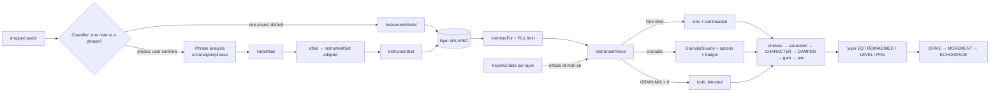
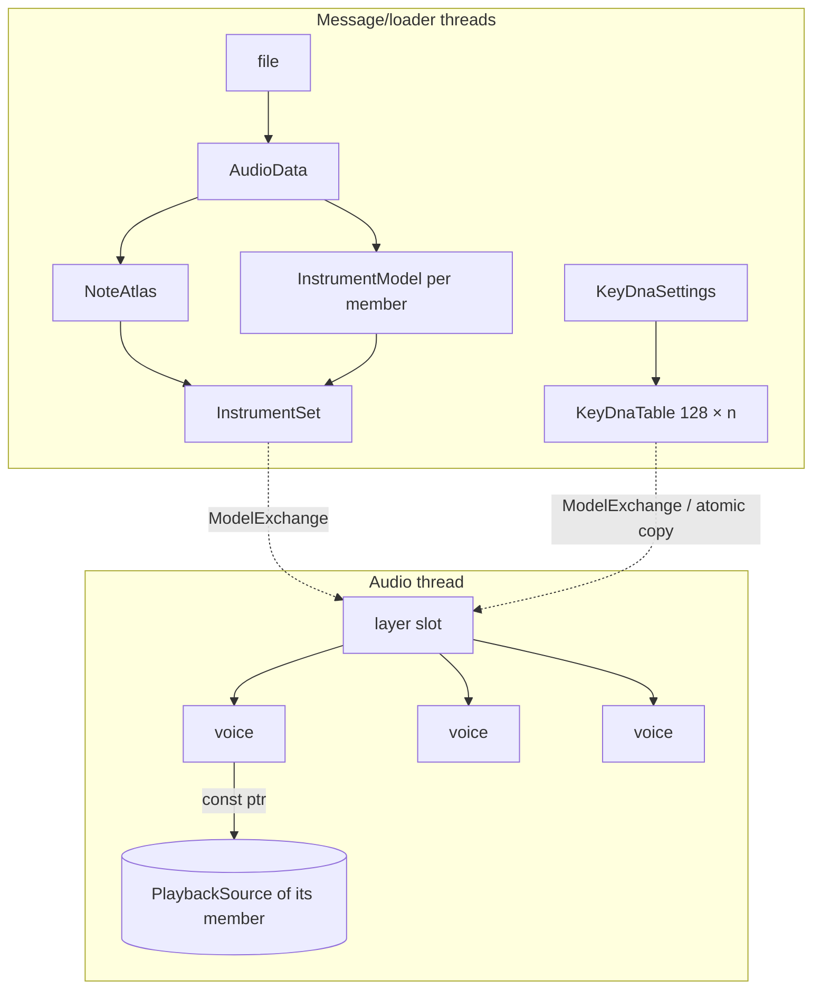

# 04 — Unified architecture: options and recommendation

## 1. Cross-engine comparison (from code and this session's benchmarks)

| Capability | OSP today | Grain prototype | Phrase prototype | Recommended unified implementation |
|---|---|---|---|---|
| Sample loading | hash store, loader pool, `ModelExchange`, relink (`InstrumentLoader.cpp`) | own `AndorStore` | own `AndorStore` | **OSP's loader + Library store**; prototypes' stores dropped |
| Granular playback | per-voice `GranularSource`, SIMD, live pitch | per-voice scheduler, global pool | 8-grain bloom only | **OSP `GranularSource`, extended** (05) |
| Polyphony | 24 per layer ×3, shared 208-slot pool | 16 voices | 32 voices | **OSP's pool**, unchanged |
| Per-key parameters | none for granular (DAMPEN curve per key; NOTE as mod source) | KEY DNA 128×7 | — | **KEY DNA table per layer** applied in `notesGranular()` (07) |
| Pitch mapping | root per sound; nearest set member, unlimited | atlas regions + policies | atlas + FILL limits | **`InstrumentSet` + FILL limit + assigned keys** (06) |
| Note Atlas | absent (sets of separate files) | consumes | produces | **atlas → `InstrumentSet` adapter**, atlas JSON in the layer's state |
| Natural playback | sinc + continuation + release graft | — | sinc + single loop | **OSP's** |
| Sustained playback | continuation multi-loop walk | — | one loop | **OSP's continuation per member** |
| Modulation | one matrix, 12 sources, A/B/C dests, meta-mod | second 8-slot matrix | none | **OSP's only**; KEY DNA is not a matrix |
| Sample variation | set round-robin; LIFE TAKES | trigger variation | variations (rr) | **set takes = atlas variations**; LIFE = per-trigger |
| Effects | per-voice CHARACTER/DAMPEN, per-layer EQ/REIMAGINED, global DRIVE/MOVEMENT/ECHO/SPACE | SharedFx (OSP reverb/echo) | SharedFx | **OSP's** |
| State | APVTS + custom XML, stateVersion 12, migrations | own XML v1, no migration | own XML v1, atlas embedded | **OSP state 13**: new params neutral, atlas per layer |
| CPU / memory (this VM, 48 kHz/256) | 3 layers granular 8 notes 12–14 %; one-shot 8 notes 4–5 % per layer | 8 voices 5.2 %; stress 16 voices 18.7 % | 8 voices 4.5 %; 2 copies of the audio | per-layer costs add; budget bounds grains (09) |

**Duplicated functionality across the three:** content store (×3), voice/steal/envelope
shells (×3), round-robin (×3), sustain looping (OSP continuation vs Phrase loop), reverb/echo
wrappers, LFO/filter/smoother utilities, region selection (OSP `memberFor`, Grain
`chooseRegion`, Phrase `chooseRegion`).

## 2. Three credible architectures

### Architecture A — Minimal OSP extension (recommended)



- **Retained unchanged:** `InstrumentEngine` voice pool and mixer, `InstrumentVoice` chain,
  `ContinuationModel`, `Modulation`, `PostProcessor`, loader, store, state machinery.
- **Extended:** `GranularSource` (options + budget hook), `InstrumentVoice::notesGranular`
  (DNA offsets), `memberFor` (fill limit), `InstrumentSet` (atlas provenance), plugin state.
- **New:** `src/engine/KeyDna.{h,cpp}` (ported), `src/analysis/phrase/*` (ported),
  `src/model/NoteAtlas.h` + `src/io/NoteAtlasJson.*` (ported), an atlas → set adapter, GUI
  pages (NOTE MAP, KEY DNA) built from existing components.
- **Risks:** per-member models copy region audio (memory ≈ the regions' length, not 128 ×);
  state 13 migration; GUI density in triple mode.
- **CPU:** identical to today when features are off; KEY DNA costs one table read per note;
  hybrid costs ≈ one-shot + granular per voice.
- **Tests:** "off is bit-identical" on all reference renders; DNA determinism; atlas set
  equivalence; budget never denies in legacy scenes.

### Architecture B — Unified playback voice

Extract a `PlaybackVoice` abstraction (natural / granular / hybrid strategies) from
`InstrumentVoice`, with regions as first-class sub-ranges of one shared `PlaybackSource`.

- Cleaner on paper (one voice type, shared buffers, no per-member copies).
- Requires refactoring `InstrumentVoice` (1 448 lines whose per-sample order is locked by
  bit-exact reference renders), `ContinuationModel` (whole-buffer analysis), `PitchLayer` and
  `PlaybackPreparation` (regions), and every REIMAGINED mode engine's coupling to the voice.
- **Risk: high.** The reference renders, LIFE determinism and continuation tests all sit on
  the exact code paths that would move. Rule 7 ("do not break the baselines") and the brief's
  own principle ("evolve, don't replace") both argue against it now.

### Architecture C — Shared DSP engines with compatibility adapters

Run OSP's voice for natural playback and the Grain engine for granular, behind a unified
source API, with an adapter mapping OSP granular parameters onto Grain.

- Keeps Grain's code nearly as is, but **two granular engines, two modulation matrices, two
  voice pools, two budgets** — exactly what the brief wants to avoid.
- Legacy granular presets would **not** be audio-identical (different scheduler, windows,
  normalisation, frozen pitch, no FOLLOW / doubling / mode engines), so a legacy path stays
  anyway: C ends up as A plus a second engine.

## 3. Recommendation

**Architecture A**, because the audit shows OSP already has the two hard parts — a
per-voice polyphonic granulator and a multi-region `InstrumentSet` with region selection,
round-robin and velocity layers. What the prototypes add are **data** (a KEY DNA table, a
Note Atlas) and **analysis** (phrase segmentation), plus small DSP options. Those slot into
existing seams (`notesGranular()`, `memberFor()`, the set builder) without touching the
locked per-sample chain. B can still happen later for memory reasons (shared-buffer regions)
once A has proven the musical value; nothing in A blocks it.

## 4. Proposed module structure

```text
src/engine/KeyDna.{h,cpp}            port of andor/grain/KeyDna (OSP parameter set), pure C++
src/engine/GranularSource.*          + options (pitch scatter, pan, reverse prob., window) + budget hook
src/engine/GrainBudget.h             engine-level counter, fair share; neutral by default
src/model/NoteAtlas.h                port of andor/atlas/NoteAtlas (schema 1)
src/io/NoteAtlasJson.*               port of andor/io/NoteAtlasJson
src/analysis/phrase/*                port of PhraseAnalysis + yin-viterbi + PhraseEdits
src/engine/AtlasSet.{h,cpp}          NoteAtlas + audio → InstrumentSet (members per included note)
apps/plugin/Source/KeyCurveEditor.*  one key-curve editor extracted from DampenEditor/ModCurveView
apps/plugin/Source/NoteMapPage.*     in-display page beside EQ | DAMPEN
```

## 5. Ownership



Everything the audio thread reads is immutable and published lock-free; a new atlas or DNA
table becomes visible to new notes only, playing voices keep theirs (already how sets and
DAMPEN behave).
