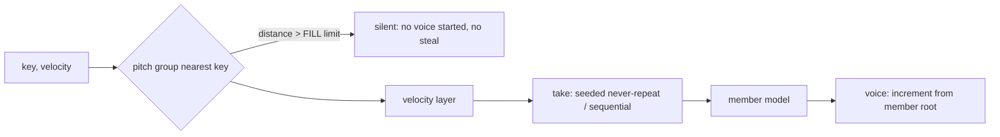

# 06 — Note Atlas inside A/B/C

**Phrase changes how material is organised; granular changes how it is played.** In OSP
those are already two separate axes: a layer holds a *model or a set* (organisation), and a
voice plays it in *One Shot or Granular* (playback). The Note Atlas is a new way to *build a
set*; it needs no new playback mode.

## 1. Representation

| Atlas concept | OSP structure | How |
|---|---|---|
| source asset (hash, path) | the layer's `Instrument` tree (`contentHash`, `originalPath`) | as today; relink by hash |
| included note (region) | `SetMember` with its own `InstrumentModel` | region audio → member model (see §2) |
| note pitch / cents | member root (`PlaybackSource::root`) | fractional `midiPitch`, so cents are honoured |
| `assignedKey` (PLAYS ON) | member root shifted to the assigned key (untransposed on it) | `SetAssignment.rootMidi` already exists |
| variation group / index | round-robin `take` in a pitch group (role `roundRobin`) | existing seeded never-repeat choice |
| loudness differences | velocity layers (≥ 4.5 dB gaps, existing inference) | optional; Phrase has none |
| `Corrections` | `SetMember.userAssigned` + the atlas itself (kept as data) | the atlas stays the source of truth |
| FILL limit | **new** `fillLimitSemitones` in `memberFor` | default unlimited = today's sets |
| sustain / release markers | member model's continuation analysis | run on the member's audio |
| `grainRegion` | the member's buffer itself (POS 0..1 spans the note) | grains stay inside the note for free |

**A one-shot stays the trivial case** — one file, one model, no set, no atlas, no analysis
beyond today's. An atlas only exists when the user maps a phrase.

## 2. Member audio: copies first, shared views later

- **Step 1 (recommended): region copies.** For each included note, copy
  `attackStart − pre-roll .. sourceEnd` into its own `AudioData` and build the member with the
  existing `instrument::buildSet` path (continuation, analysis, levelling all work unchanged).
  Memory ≈ the summed region lengths + padding (regions do not overlap, so ≈ the phrase itself,
  ×2 for the padded copy as today) — not 128 copies. Build time: one analysis per note
  (measured: the whole phrase analyses at ≈ 40× real time; member continuation analysis is the
  existing per-sound cost).
- **Step 2 (only if memory/time demands it): shared-buffer regions.** Give `PitchLayer` /
  `PlaybackPreparation` a frame range on one shared `PlaybackSource`, and make
  `ContinuationAnalyzer` accept a sub-range view. That is Architecture B's core and touches
  locked code; defer until measured necessary.

## 3. Region selection per note

Changes to `memberFor` (`InstrumentEngine.cpp:367-414`): the FILL limit check **before**
allocating a voice (avoids the wasted steal found in Phrase); exact-key preference when an
assigned key exists; everything else is today's code.

## 4. Lifecycle

- **Load / re-analysis / edits** build a new set off the audio thread and publish it through
  the layer's `ModelExchange`; voices keep their member model until they end (sets already
  work this way: `isSetInUse`, `killVoicesUsing`).
- **Edits and active voices**: a held note keeps playing the region it started with; the next
  note uses the edit. Same as Phrase and as today's Samples inspector.
- **Sustain and release**: each member has OSP continuation (multi-loop walk, release graft) —
  better than Phrase's single loop. LOOP off plays the region once.
- **Granular on an atlas**: the voice's `GranularSource` reads its member's buffer, so POS,
  SIZE, DENS act inside the note; KEY DNA per key works the same. (Grain's MAPPED policy,
  for free.)
- **Per-layer stages** that read the primary member (REIMAGINED stage, auto-POS) stay as they
  are; documented limitation, unchanged behaviour.

## 5. Phrase analysis inside OSP

- Port `PhraseAnalysis` (+ `yin-viterbi`, `PhraseEdits`) to `src/analysis/phrase` — pure C++,
  `osp_dsp`, testable headless (Rule 4) and from `research-renderer`.
- Entry point: OSP's Library `Classifier` already marks "several notes in a row"
  (`multipleEvents`); on such a drop the card offers *Play as one sound* (default — the
  non-negotiable workflow) or *Map its notes*.
- Persist the atlas JSON in the layer's `Instrument` tree under its own `schemaVersion`
  (stateVersion 13), plus a content-hash cache like Phrase's
  (`<hash>.phrase-v<ver>-<digest>.andoratlas`) in the Library store.

## 6. Three independent atlases with granular (brief Q7)

Each layer resolves its own member per note; each voice runs its own grains; the only shared
resources are the voice pool (208 slots, 24 per layer) and — proposed — the global grain
budget with fair share. Measured on this VM (48 kHz/256): one layer with a 12-member set, 8
notes 2.5–2.8 %; set + two granular layers, 8 notes 10–12 %. Memory: three phrases of 30 s
stereo ≈ 3 × 2 × 11.5 MB ≈ 70 MB with region copies (estimate from the lab's figures).
