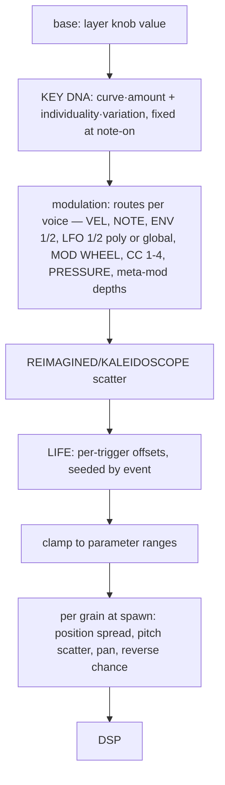

# 07 — Modulation and KEY DNA

## 1. NOTE modulation vs KEY DNA

| | NOTE (exists) | KEY DNA (proposed) |
|---|---|---|
| What | a *live modulation source*: the played key through a curve | a *persistent definition* of how each key's granular voice behaves |
| Scope | global curve, routed to any destination by a route | per layer, granular parameters only |
| Randomness | none | seeded per-key individuality (stable) |
| Where | `Modulation.cpp:889-897` (`curveAt(noteCurve, note/127)`) | `KeyDnaTable` read once at note-on |
| Cost | one route slot per destination | no route slots |

They share **the curve and its editor**, not the semantics. KEY DNA must not become a second
matrix: it has amounts (parameters) that can themselves be modulation destinations, exactly
like DAMPEN.

## 2. Precedents in OSP

- **DAMPEN** (`src/engine/Dampen.h:31-48`, `InstrumentVoice.cpp:650-678`): a per-layer key
  curve × AMOUNT, AMOUNT is a destination (`dampenAmountA..C`), curves stored as entries 6-8
  of the `"c3:"` curve set. KEY DNA = the same pattern with several parameters and a seeded
  individuality term.
- **LIFE TAKES** (`PerformanceEngine.cpp:145-156`): stateless per-key profiles from
  `deriveSeed(baseSeed, "take", reroll)` and `(note, take)` — the precedent for an individuality
  that needs no stored table.
- **`NoteShape.grain*`** fields, applied per voice in `notesGranular()` — the injection point.

## 3. Proposed KEY DNA in OSP terms

- Data: per layer, `KeyDnaSettings` = per-parameter curves (reuse `mod::Curve` — 16 points +
  tension — not Grain's linear `DnaCurve`, so one editor and one serialisation serve NOTE, VEL,
  DAMPEN and DNA), CURVE amount, VARIATION, INDIVIDUAL, seed.
- Parameters (first version): POS, SIZE, DENS, SPREAD, TUNE (all existing granular
  parameters); SCATTER and PAN when those options land (05 §2).
- Table: 128 × n floats, computed off the audio thread on change and published lock-free (or
  allocation-free on the audio thread, as Grain does — it is ~1 000 PRNG draws).
- Seeds: `deriveSeed(layerSeed, <new "dna" tag>, key)` — a new tag; never an existing one
  (Rule 2, `PrngTests.cpp:28`).
- Parameters for automation: `layerX.dna.amount`, `.variation`, `.individual`, `.seed`
  (hint 20, neutral defaults); destinations appended as A/B/C triples (`dnaAmountA..C`,
  `dnaVariationA..C`) after `dampenCutoffC`.
- Curves: a new property (`keyDna` with its own version prefix) rather than growing `"c3:"`,
  so the existing curve decoder and its tests stay untouched.

## 4. One evaluation sequence

Interactions:

- **Velocity / AMP envelope**: unchanged (amplitude path); VEL can still route to grain
  destinations on top of DNA.
- **ENV, LFO 1/2**: per voice (poly) or global as today; they modulate around the DNA value.
- **Mod Wheel / CCs / Pressure / Macros**: global sources, unchanged; macros' LIFE scales the
  per-trigger stage only.
- **Meta-modulation**: can move the depth of a route onto `dnaAmountX` like any other route.
- **Polyphony**: DNA is per key, so two notes on different keys differ even with identical
  modulation; the same key re-struck keeps its identity (variation per trigger comes from LIFE).
- **Host automation**: DNA amounts are automatable; curves are session data (as NOTE/VEL/DAMPEN
  curves are today).
- **Smoothing**: DNA is fixed per note; held notes keep their snapshot when the curve changes
  (like Grain, and like DAMPEN's `dampenNote`).

## 5. Curve editor

Extract one `KeyCurveEditor` from the two existing editors (`ModCurveView` in
`ModulationPanel`, `DampenEditor` in `EqEditor`) — they duplicate point editing. Needs:
a key↔x mapping callback (so it can align with the real keyboard), bipolar y, and an optional
background layer (DNA individuality bars, live voice dots — the interactions Grain's
`KeyDnaEditor` proved). The NOTE tab, DAMPEN page and KEY DNA page then use one component.

Note: the GUI audit found an unconfirmed bug from code reading — the VEL/NOTE "expand" and
"Edit curve…" call `openModulationPopup(curvePopup, 5|6)`, which returns early for
`source > 3` (`PluginEditor.cpp:1429-1432`), so the large VEL/NOTE editor may never open.
Worth checking before building on that path.
