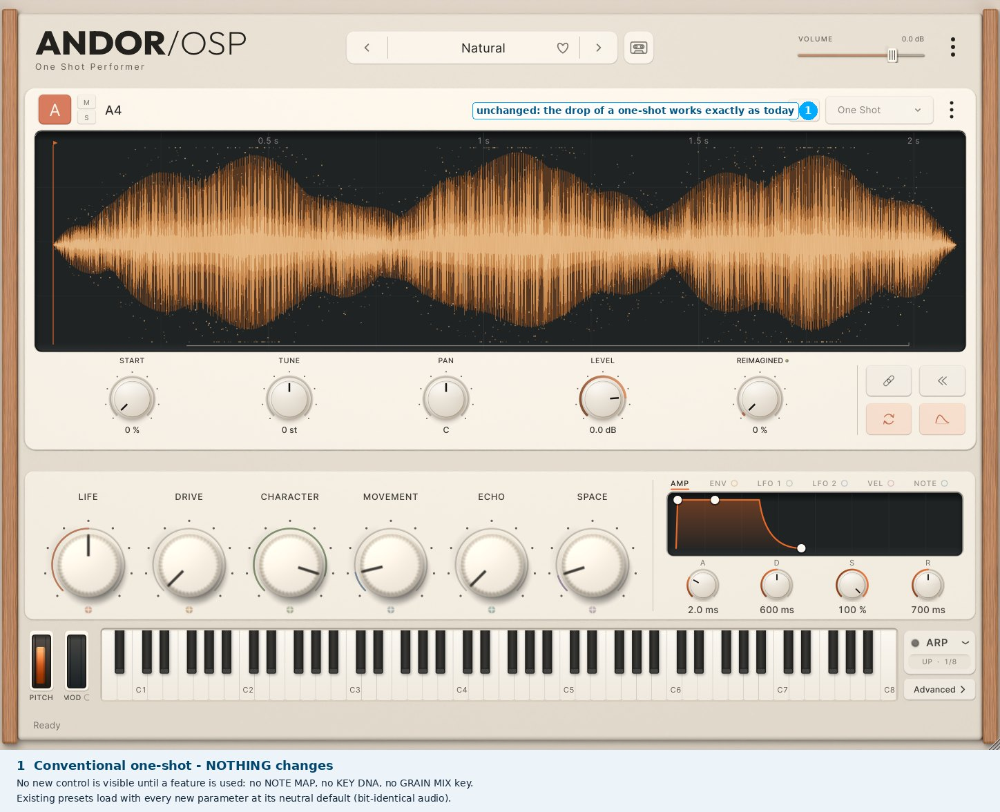
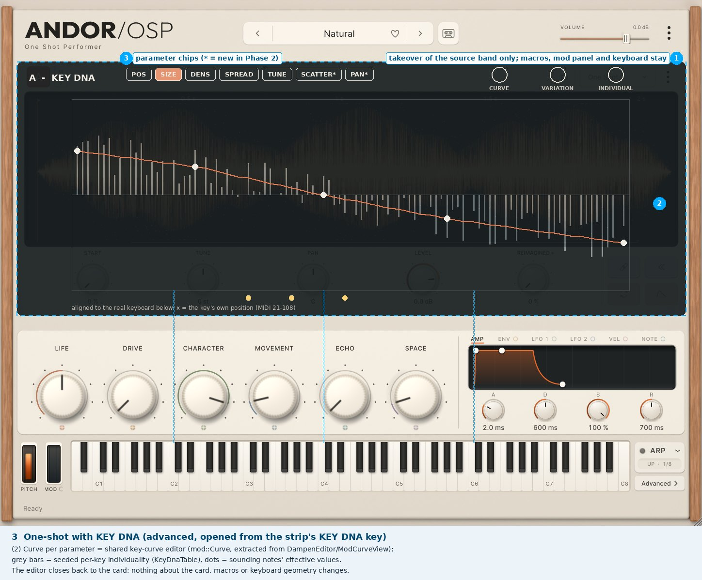
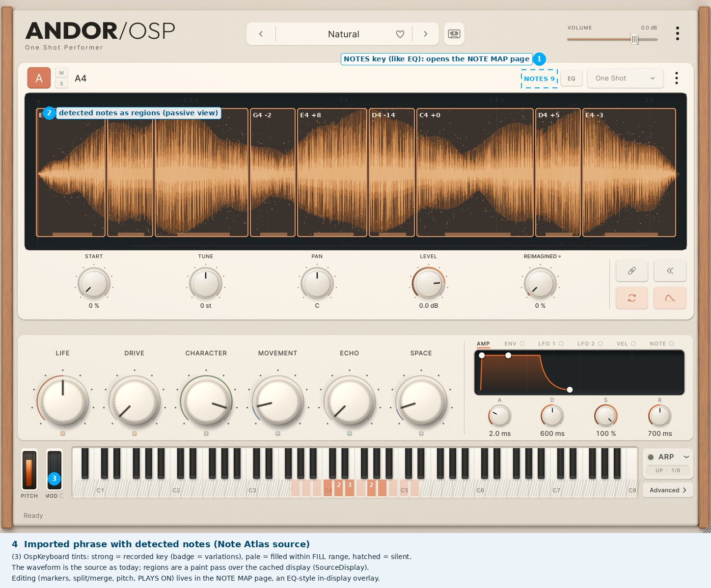
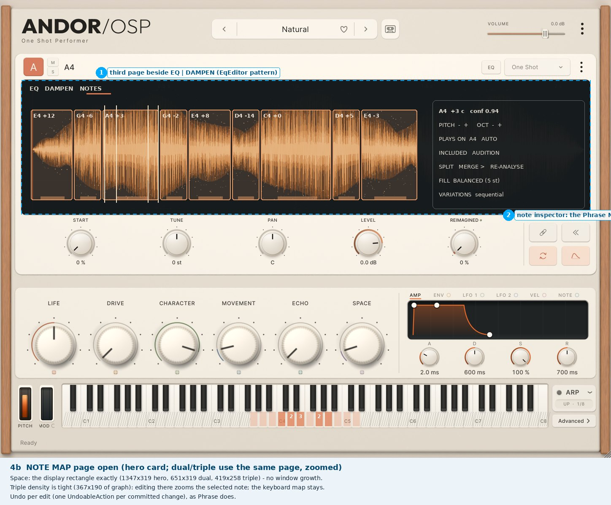
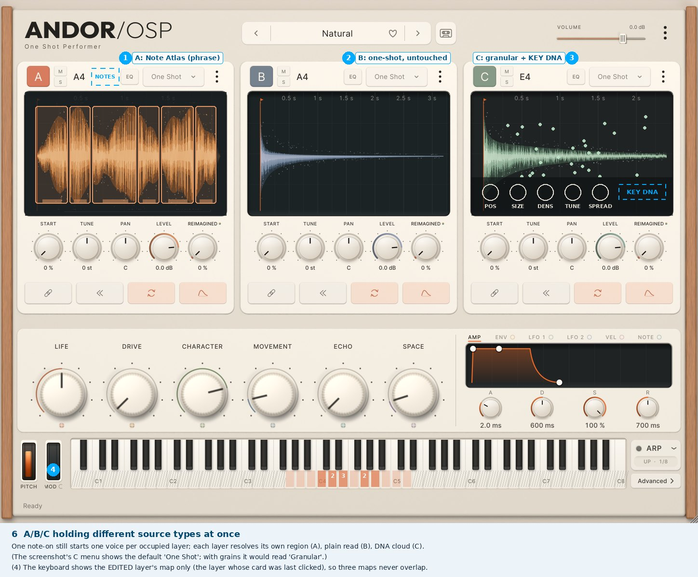

# 08 — GUI proposals (inside the existing layout)

All mockups are **real screenshots** of the current plugin (ceramic skin, rendered headless
from `build-plugin` at `db136e5`) with proposal overlays drawn on top by
`mockups/make_mockups.py`. Overlays use one deliberately foreign colour (cyan, dashed) to show
*where* something lives and *how big* it may be — not how it is styled. Any implementation
uses the existing components and skin.

## 1. Space budget (reference canvas 1448×1086, verified in `Design.h` / `PluginEditor.cpp`)

| Slot | Precedent | Size | Key-aligned | Use |
|---|---|---|---|---|
| In-display page beside EQ \| DAMPEN | `EqEditor` | 1347×319 / 651×319 / 419×258 | no | **NOTE MAP** |
| Whole-card overlay | `SamplesPanel` | 1355×365 / 659×365 / 427×365 | no | note list (sets) |
| Source-band takeover, keyboard live | `LibraryPanel` | band 1379×525 | **yes** (x 148–1298) | **KEY DNA editor** |
| Popover above the mod panel | `ModCurvePopup` | 640×330 | no | quick DNA curve |
| Keyboard in-key tint (lower 38 % of white keys) | `OspKeyboard` draw hooks | 1150×101 | yes | NOTE MAP state, DNA values |
| Strips at the keyboard | free | 1150×15 above, ~1150×22 below | yes | not needed |
| ARP-style drawer | `ArpInlinePanel` | grows the window | — | **avoid** |

## 2. Are SOURCE | NOTE MAP | GRAIN tabs right?

Not as tabs. The card already has a pattern that costs zero clicks for the common case:
the **EQ key opens an in-display page set** (EQ | DAMPEN), the **granular controls appear on
hover**, and **the mode menu** chooses the playback. So:

- **SOURCE** is the card itself — unchanged.
- **NOTE MAP** is a *third page* of the in-display set, reached from a **NOTES** key that
  exists only when the layer holds an atlas. It is useless for one-shots, so it never shows
  for them.
- **GRAIN** is the existing hover strip; a **KEY DNA** key at its end opens the band-takeover
  editor aligned to the real keyboard. The basic granular controls stay one hover away.
- **Natural ↔ Grain** (if chosen): one GRAIN MIX control. Where it goes is an open decision
  (see brief): in the One Shot hover strip, or as a route-only parameter.

## 3. The six states

1. **Conventional one-shot — nothing changes** (`mockups/01-one-shot-unchanged.jpg`).
2. **One-shot through the existing Granulator — unchanged** (`02-granular-unchanged.jpg`).
3. **One-shot with KEY DNA** — band takeover, curve per parameter, individuality bars,
   sounding-key dots, x aligned to the real keys (`03-key-dna-editor.jpg`).
4. **Imported phrase with detected notes** — passive regions over the waveform, NOTES key,
   keyboard tints (recorded / filled / silent), variation badges (`04-phrase-note-map.jpg`);
   the NOTE MAP page open with markers and a note inspector (`04b-note-map-page.jpg`).
5. **Phrase with granular playback** — grains inside each note's region, KEY DNA key
   (`05-phrase-granular.jpg`).
6. **A/B/C with different source types** — A atlas, B one-shot, C granular + DNA; the keyboard
   shows the *edited* layer's map only (`06-abc-mixed.jpg`).

## 4. What changes visibly

| Element | Change |
|---|---|
| Card header | a NOTES key, only for atlas layers (same style as EQ) |
| Granular hover strip | a KEY DNA key at its end |
| Waveform display | passive note regions for atlas layers (a paint pass over the cache) |
| Keyboard | per-key tints for the edited layer's map (draw hooks only; geometry unchanged) |
| New pages | NOTE MAP (in-display), KEY DNA (band takeover) |
| Unchanged | window size, card geometry, macro row, mod panel, ARP, keyboard geometry, skin |

## 5. Open GUI risks

- Triple density NOTE MAP is tight (367×190 of graph) — editing zooms to the selected note.
- Three atlases' keyboard maps cannot be shown at once; the edited layer wins.
- The DNA editor hides the cards while open (by design, like the Library); closing returns.
