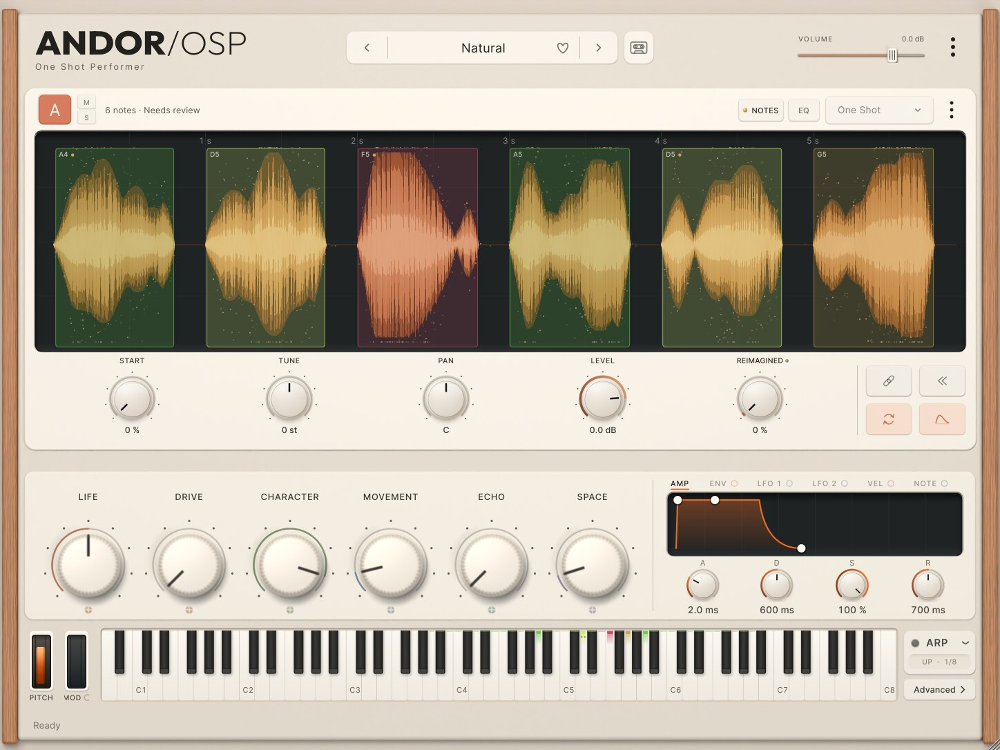
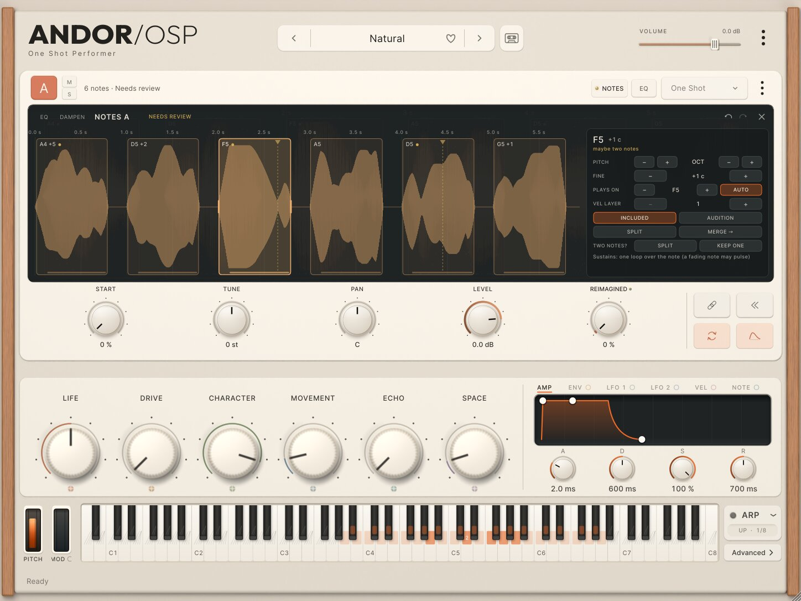
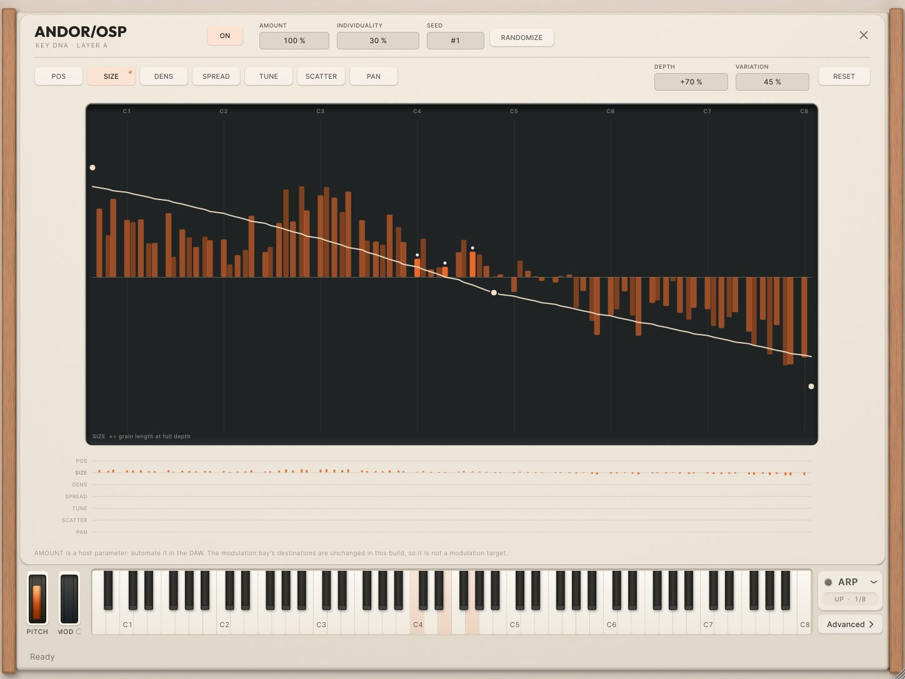

# Unified engine Phase 5: NOTE MAP and KEY DNA in the real interface

Phase 5 puts the work of Phases 1–4B in a musician's hands, inside ANDOR OSP's existing
interface. There is no new engine, no separate plug-in, no new panel and no new artwork. The
window keeps its size. An ordinary one-shot looks and plays exactly as before.

The flow:

1. load a recording;
2. **Map notes…** (layer menu);
3. play the notes at once;
4. open **NOTES** to see and correct them;
5. switch One Shot / Granular;
6. open **KEY DNA** from the Granular strip;
7. save and reopen the session with everything kept.

Screenshots are real renders of the plug-in. The images below use the test suite's synthetic
phrase (no private audio) and are in `phase5/`. Each comes from the snapshot test
(`OSP_SNAPSHOT_DIR`, `tests/plugin/UnifiedPhase5Tests.inc`).

## 1. What the musician sees

| State | Screenshot |
|---|---|
| An ordinary one-shot: unchanged (no NOTES key, no regions, no analysis) | `phase5/p5-01-one-shot-unchanged.jpg` |
| MAP NOTES pressed: the display says ANALYZING, the header "Analyzing" | `phase5/p5-02-analyzing.jpg` |
| Mapped: the notes as quiet regions over the waveform, "6 notes · Needs review", the NOTES key, the keyboard's map | `phase5/p5-03-mapped.jpg` |
| NOTE MAP open (hero), nothing selected: the map's own controls | `phase5/p5-04-note-map.jpg` |
| A note selected: its pitch, key, doubts, repeat marker, sustain | `phase5/p5-05-note-selected.jpg` |
| Dual and triple density (the same page, the display's size) | `phase5/p5-06-note-map-dual.jpg`, `phase5/p5-07-note-map-triple.jpg` |
| Granular: the KEY DNA key at the end of the hover strip | `phase5/p5-08-granular-strip.jpg` |
| KEY DNA editor over the instrument, the profile over the real keys, held keys marked | `phase5/p5-09-key-dna.jpg` |
| A mapped, B one-shot, C Granular with KEY DNA | `phase5/p5-10-abc.jpg` |
| A phrase just dropped: "Identify notes?" at once (after the musical review) | `phase5/p5-11-identify-notes.jpg` |

### Where things live (the approved proposal, 08-gui-proposals.md)

| Element | Where | Visible change |
|---|---|---|
| **Map notes…**, **Notes**, **Detect notes again** (FEWER / NORMAL / MORE), **Play as one sample** | the layer's ⋮ menu | menu items only |
| **NOTES** key | the card header, left of EQ, same key | only on a Note Atlas layer |
| Status | where the file name would be: "6 notes · Ready" | only on a Note Atlas layer, or while MAP NOTES analyses |
| Note regions | painted on the cached waveform | only on a Note Atlas layer |
| **NOTE MAP** page | the display's rectangle exactly (1347×319 / 651×319 / 419×258), mutually exclusive with EQ / DAMPEN; its tabs say EQ DAMPEN NOTES | while open |
| Keyboard map | a band in each key's lower part: recorded (strong, takes counted), filled (pale), silent (two faint strokes) | the edited layer's map only |
| **KEY DNA** key | the end of the Granular hover strip | the strip's five knobs share a little less width |
| **KEY DNA** editor | the Library's band (over cards, macros and mod panel), keyboard live below | while open |

Unchanged: the window, card geometry, macro row, modulation panel, ARP, the keyboard's geometry,
the skin and every asset. The NOTES and KEY DNA keys use the existing key roles (EQ's key) and
cells (the EQ page's), and the NOTE MAP uses the EQ page's graphite well and type.

## 2. NOTE MAP

- **Regions**:
  - every note over the recording;
  - its played key (with cents when there is room);
  - a bar along its foot marks its stable body;
  - a note left out has a dashed outline;
  - a note played on another key says "from E4".
- **Doubts** stay restrained. No confidence numbers are shown.
  - An amber dot marks a doubt. A ring marks a place where a re-detection disagrees.
  - The words appear only for the selected note: "pitch uncertain", "maybe an octave off",
    "maybe two notes", "boundary uncertain", "mostly breath or noise", "a quieter take".
  - The page's status reads "Needs review" while any untouched note carries a doubt.
- **Select, zoom, scroll**:
  - click a note to select it; shift-click selects a range, cmd/ctrl-click adds one;
  - ← / → steps between notes;
  - the wheel zooms around the pointer; shift or a horizontal wheel scrolls;
  - dragging the background scrolls.
- **Audition**:
  - a click on a note plays it as recorded (AUDITION, space), outside the instrument and its
    effects, with 4 ms fades;
  - the keyboard plays the instrument.
- **Boundaries**:
  - drag a note's start or end; it stays between its neighbours and at least 30 ms long;
  - the moved note is described again from the audio; a corrected pitch is kept.
- **Pitch**:
  - PITCH −/+ and OCT −/+ change the note's root;
  - FINE −/+ moves it in 5-cent steps (in tune, it is played corrected).
- **Key remap**:
  - PLAYS ON −/+ plays the note on another key; AUTO returns it to its own key;
  - with several notes selected they all go to one key, which is how takes become one key's
    round robin;
  - VEL LAYER sets velocity layers.
- **Include / leave out**: INCLUDED / LEFT OUT.
- **Split**:
  - double-click inside a note, or SPLIT (at a repeat marker when there is one, else the
    middle);
  - a possible repeat (Phase 4B) is a dashed line with a small tab: one click splits there,
    KEEP ONE answers the doubt.
- **Merge**: select neighbouring notes, then MERGE (one note: with the next).
- **Sustain** is explained per note from what the instrument actually built:
  - "Sustains from its stable body";
  - "Sustains: one loop over the note" (the musical review's loop-every-note rule, below);
  - "Plays as recorded: under 0.1 s of sound to loop";
  - "Sustain being prepared" (Stage A);
  - "LOOP is off"; "Granular: grains hold it";
  - "Not loaded: the layer's memory is full".
  
  The map's summary counts how many notes sustain. There are no new sustain controls: LOOP
  stays the switch.

  **After the musical review: every note of 0.1 s or more loops.** The shortest region a note
  sustains from drops from 0.3 s to 0.1 s (`atlasset::BuildOptions::minSustainSeconds`), and a
  note the continuation analysis would not loop (a fading note, no compatible loop points, a
  short stable body) gets one crossfaded loop over its body instead, its destination aligned on
  the waveform (`ContinuationOptions::forceLoop`, reason "loop over the note";
  `BuildOptions::loopEveryNote`, on). A fading note's loop may pulse a little. Notes the analysis
  already looped keep exactly their loops. Ordinary samples and sample sets are unchanged
  (forceLoop is off outside the atlas). Tests: `tests/integration/AtlasShortSustainTests.cpp`.

  **After the musical review: "Identify notes?" on drop.** Dropping a phrase used to show
  nothing (MAP NOTES lived only in the layer menu). Now a dropped recording that lasts a second
  or more and whose ordinary load hears two or more held pitches asks at once, on the card over
  its waveform: "Identify notes? · N heard", MAP NOTES / NO
  (`phase5/p5-11-identify-notes.jpg`). No extra analysis runs to ask: the count is the
  Library classifier's `heldNotes` over the pitch track the load already has (pitches held
  0.2 s or more; a move of an octave or a fifth is not counted, since pitch trackers slip by
  those on one note). NO keeps the ordinary sample and does not ask
  again; MAP NOTES stays in the menu. A recalled session, a one-note sound, a multi-sample set
  or an atlas never asks. A phrase that repeats one pitch, or only leaps by octaves and fifths, is
  heard as one note and is not asked about (MAP NOTES in the menu still maps it).
- **The map, nothing selected**:
  - DETECTION FEWER / NORMAL / MORE, a background re-detection;
  - FILL on/off and its reach (±1..48 st);
  - TUNING (IN TUNE / AS PLAYED);
  - the recording's verdict (unsuitable, silent, notes not loaded);
  - the last re-detection's report ("2 corrections kept; 1 place where the new detection
    disagrees").
- **Conflicts**: a corrected note the new detection disagrees with has a ring. KEEP MINE
  dismisses it; USE NEW re-describes the note from the audio.
- **Undo / redo**:
  - every edit is one undo step, named ("Pitch D5 → E5", "Split note", "Merge notes",
    "Move note start", "Fill keyboard", "Detect notes (MORE)", "Map notes A");
  - the page has its own undo and redo arrows; the host and editor's undo work as before.

## 3. How an edit works (and why held notes survive)

`InstrumentHost::editAtlas (layer, name, edit)` is the only way the interface changes an atlas.
There is no shadow model.

1. The edit closure (PhraseEdits: setRoot, moveMarker, split, merge, assignKey, setIncluded, ...)
   runs on the loader thread. It gets a copy of the layer's atlas and the recording's decoded
   audio: the layer keeps it from its load, or it is read back from the sample store by hash.
2. The result is repaired, built through Stage A (`loadInstrumentAtlas`, the preloaded source
   reused, no decode) and published at once. Stage B follows in the background.
3. Publication goes through ModelExchange with a fresh generation. Deferred destruction keeps
   the instrument a held note started with alive. A note held through an edit keeps sounding,
   and the audio thread allocates nothing (tested over the whole swap, Stage A and B).
4. Edits asked for while one is being prepared wait in a queue of at most 32. Each edits the
   result of the one before.
5. Undo and redo show the cached instrument of either state at once (eight kept per layer).
   An evicted state is prepared again from its atlas, without a new undo step.
6. An edit that changes nothing publishes nothing and makes no undo step.

MAP NOTES on an ordinary sample analyses its copy in the sample store (`analyseRecording`, the
Phase 4 job, its cache) and is one undo step back to the ordinary sample. On an atlas, DETECTION
runs `analysePhrase` and `mergeReanalysisReported`:

- every correction is kept exactly;
- untouched notes come from the new detection;
- disagreements are reported;
- the atlas keeps its id, sources and FILL.

**Play as one sample** brings the recording back as an ordinary sample (undoable).

Status (`InstrumentHost::atlasActivity` and `NoteMapEditor::statusOf`) moves through Analyzing,
Preparing (an edit), Playable · enhancing (Stage A playing, Stage B coming), Ready, Needs
review and Failed. An unsuitable recording stays one ordinary sample and says why (Phase 4).

## 4. KEY DNA editor

- **Global**:
  - ON;
  - AMOUNT, the host parameter `layerX.keyDna.amount`: live on sounding notes and automatable;
  - INDIVIDUALITY (Smooth .. Individual);
  - SEED, and RANDOMIZE (a new seed derived from this one with `Prng::deriveSeed`,
    reproducible; the session stores it).
- **Per parameter** (POS SIZE DENS SPREAD TUNE SCATTER PAN, one at a time, a dot on each that
  moves something):
  - the curve over the keys (drag a point, double-click to add or remove one, drag the line to
    bend it, as DAMPEN's and the modulation curves);
  - DEPTH, VARIATION and RESET.
  
  A curve drawn while DEPTH is 0 starts at 50 % depth and switches KEY DNA on, so a drawn
  curve is always heard.
- **The profile per key**:
  - under every key, its offset for the shown parameter, AMOUNT applied;
  - below, the seven parameters at a glance;
  - held keys are marked.
  
  It is computed by the same deterministic `keydna::Table::compute` the processor publishes,
  so it is the profile played (tested equal). The x of every key is the real keyboard's key
  below. The curve's off-keyboard ends (MIDI 0 and 127) sit pinned at the graph's edges.
- **Undo**: a drag is heard as it moves and is one undo step when released (KeyDnaChangeAction
  carries settings and drawn curves).
- **State**: the drawn points are saved beside the compiled curve (`points` on each `Param`,
  additive, schema 1 unchanged, docs/analysis-schema.md). A session from before Phase 5 opens
  its curve as nine points along the compiled table.
- **Modulation**: the modulation bay's 75 route destinations are frozen (appending would shift
  saved automation indices). KEY DNA AMOUNT is therefore **not** a modulation destination in
  this build. It is a host parameter: automate it in the DAW. The editor says so. A versioned
  extension of the destination list remains a possible later step and needs its own migration.

## 5. Ordinary samples, A/B/C, performance

- Workflow A: an ordinary sample is never analysed by itself. It gets no NOTES key, no regions
  and no status text, and its card renders as before.
- Workflow D: A (atlas), B (one-shot) and C (Granular + KEY DNA) play together. Each card shows
  only its own context; the keyboard shows the edited layer's map (tested).
- Message thread:
  - the waveform and regions are painted from the existing peak overview;
  - the keyboard map is recomputed only when the atlas or edited layer changes;
  - the KEY DNA table (about 1 800 PRNG draws) is recomputed only when settings change.
- Loader thread: analysis and edits.
- Audio thread: unchanged. No allocation, lock or I/O was added; the new tests assert zero
  allocations through an edit swap and while AMOUNT moves on a held chord.

## 6. Tests

`tests/plugin/UnifiedPhase5Tests.inc` (10 cases, 298 assertions; `[plugin][phase5]`):

- A unchanged;
- B MAP NOTES, undo and redo, Play as one sample;
- edits one undo step each:
  - queued in order;
  - "changed nothing" makes no undo step;
  - a held note sounds through the swap with zero allocations;
  - undo and redo walk back and forth;
- an evicted undo state is rebuilt; the edit queue is bounded;
- DETECTION again keeps two corrections, reports them, and is one undo step;
- NOTE MAP controls:
  - OCT, PLAYS ON / AUTO, SPLIT and MERGE, INCLUDE, FILL, audition;
  - the page in the display's exact rectangle; EQ and NOTES never open together;
- the session keeps corrections, FILL reach and KEY DNA curves with their points, with no audio
  in host state;
- the KEY DNA editor:
  - undoable drags;
  - the profile equals the processor's, AMOUNT applied live;
  - x aligned to the real key;
  - RANDOMIZE;
- workflow D with zero allocations and the keyboard map of the edited layer only;
- the screenshot pass.

The full suites, the [design-capture] pixel identity and the visual regression (0 px) are in
the commit message and STATUS.

## 7. Known limitations

- **Synthetic test vowel**: on lower keys the analysis can lock onto a harmonic (documented in
  Phase 4). Those notes carry a doubt and are corrected with OCT. The screenshots use keys it
  reads correctly.
- **Round robin**: takes on one key alternate in recorded order (the atlas model orders them by
  time). Their order cannot be rearranged by hand; moving notes to one key and setting velocity
  layers is supported.
- **Granular display**: in Granular mode the display's POS and SPREAD markers still refer to the
  whole recording, not to each note's region.
- **Waveform on the NOTE MAP**: a simpler silhouette than the main display's.
- **Triple density**: the NOTE MAP's rows shrink to fit; editing a single note works best zoomed.
- **No "add a missed note"**: the analysis's uncovered stretches are not drawn yet.
- **KEY DNA AMOUNT** is not a modulation destination (above).
- **Mac**: AU, VST3 and Standalone are built and validated by the macOS CI on push (unsigned
  development builds). Linux builds VST3 and Standalone locally. Host testing in Ableton is the
  musician's (`phase-5-ableton-guide.md`).
